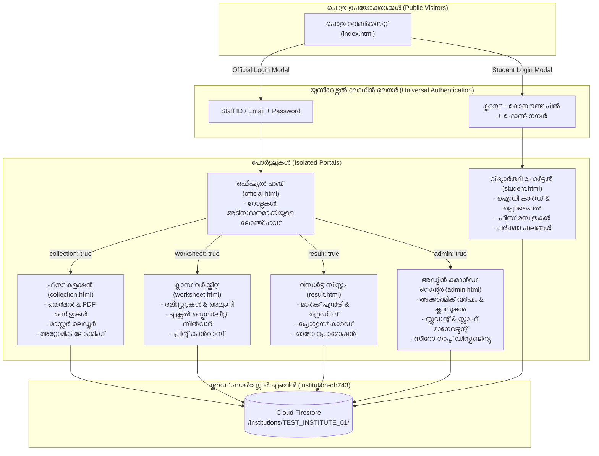

# Noorul Islam Madrasa System — Master Architecture & Functional Blueprint
*(Universal White-Label Institution Management Application)*

---

## ആമുഖം (Introduction)

നൂറുൽ ഇസ്ലാം ഹയർ സെക്കൻഡറി മദ്രസ ഉൾപ്പെടെയുള്ള **ഏതൊരു വിദ്യാഭ്യാസ സ്ഥാപനത്തിനും (മദ്രസ, സ്കൂൾ, കോളേജ്, അക്കാദമി)** യാതൊരുവിധ കോഡ് മാറ്റവും കൂടാതെ നേരിട്ട് ഉപയോഗിക്കാൻ കഴിയുന്ന വെബ് ആപ്ലിക്കേഷന്റെ സമഗ്രവും പൂർണ്ണവുമായ മാസ്റ്റർ ആർക്കിടെക്ചറൽ ബ്ലൂപ്രിന്റും ഫങ്ഷണൽ സ്പെസിഫിക്കേഷനുമാണിത്.

ആപ്ലിക്കേഷനിലെ ഓരോ പേജും (Pages), ഓരോ ടാബുകളും (Tabs), അവ തമ്മിലുള്ള പരസ്പര ബന്ധങ്ങൾ (Interconnections), യൂസർ റോളുകൾ (User Roles), ഫയർബേസ് ഡാറ്റാബേസ് ഘടന (Firestore Schema), സെക്യൂരിറ്റി റൂളുകൾ (Security Rules), ഫീസ്-റിസൾട്ട്-വർക്ക്ഷീറ്റ് പ്രവർത്തനങ്ങൾ എന്നിവ ഇതിൽ സമ്പൂർണ്ണമായി രേഖപ്പെടുത്തിയിരിക്കുന്നു.

കൂടാതെ, **ഒരേ പേരുള്ള വിദ്യാർത്ഥികൾ, ഇരട്ട അഡ്മിഷൻ, ഒരേ ഫീസ് വീണ്ടും സ്വീകരിക്കൽ എന്നിവ തടയുന്ന സമ്പൂർണ്ണ ഡ്യൂപ്ലിക്കേഷൻ പ്രതിരോധ എൻജിനും (Anti-Duplicate & Idempotency Engine)**, ആദ്യമായി ഉപയോഗിക്കുമ്പോൾ വ്യാജ ഡാറ്റകളില്ലാത്ത **ക്ലീൻ സീറോ-ഡാറ്റ എക്സ്പീരിയൻസും (Clean Zero-Data Experience)** ഇതിൽ വിശദമാക്കിയിരിക്കുന്നു.

---

## 1. Overview & Core Concept

### 1.1 സിസ്റ്റത്തിന്റെ ലക്ഷ്യം (System Purpose)
ഈ വെബ് ആപ്ലിക്കേഷൻ ഒരു വിദ്യാഭ്യാസ സ്ഥാപനത്തിന് ആവശ്യമായ എല്ലാ അഡ്മിനിസ്ട്രേറ്റീവ്, സാമ്പത്തിക, അക്കാദമിക് പ്രവർത്തനങ്ങളും ഒരൊറ്റ പ്ലാറ്റ്ഫോമിൽ ഏകോപിപ്പിക്കുന്നു:
1. **പൊതു വിവരങ്ങൾ (Public Info):** സ്ഥാപനത്തെക്കുറിച്ചുള്ള വിവരങ്ങൾ, അധ്യാപക-മാനേജ്മെന്റ് വിവരങ്ങൾ, അറിയിപ്പുകൾ, ഫോട്ടോ ഗാലറി.
2. **വിദ്യാർത്ഥി പോർട്ടൽ (Student Portal):** ഐഡി കാർഡ്, ഫീസ് കുടിശ്ശികയും രസീതുകളും, പരീക്ഷാ ഫലങ്ങൾ, അറിയിപ്പുകൾ.
3. **ഔദ്യോഗിക ഹബ് (Official Staff Hub):** സ്റ്റാഫ് അംഗങ്ങൾക്കുള്ള ഏകീകൃത ലോഞ്ച്പാഡ്.
4. **ക്ലാസ് വർക്ക്ഷീറ്റ് & രജിസ്റ്ററുകൾ (Class Worksheet & Registers):** അഡ്വാൻസ്ഡ് എക്സൽ മാതൃകയിലുള്ള രജിസ്റ്റർ ബിൽഡർ, ക്ലാസ് സമ്മറി, അലുംനി രജിസ്റ്റർ, സ്റ്റാഫ് ഡയറക്ടറി, പ്രിന്റ് കാൻവാസ്.
5. **ഫീസ് കളക്ഷൻ & ലെഡ്ജർ (Fee Collection):** ഫീസ് എൻട്രി, രസീത് പ്രിന്റിംഗ് (Thermal 58mm/80mm & A4/PDF), ബൾക്ക് എക്സൽ അപ്ലോഡ്, ഡൊണേഷൻ എൻട്രി, മന്ത്ലി റിപ്പോർട്ടുകൾ, കളക്ടർ വൈസ് സമ്മറി, മാസ്റ്റർ ലെഡ്ജർ.
6. **പരീക്ഷാ റിസൾട്ട് സിസ്റ്റം (Result Management):** മാർക്ക് എൻട്രി, ഗ്രേഡിംഗ് കാൽക്കുലേഷൻ, ഡ്രാഫ്റ്റ് റിവ്യൂ, പബ്ലിഷിംഗ് കൺട്രോൾ, പ്രൊമോഷൻ എൻജിൻ, ഡിജിറ്റൽ മാർക്ക് ലിസ്റ്റ് / റിപ്പോർട്ട് കാർഡ്.
7. **അഡ്മിൻ കമാൻഡ് സെന്റർ (Admin Command Center):** അക്കാദമിക് വർഷങ്ങൾ, ക്ലാസുകൾ, സ്റ്റാഫ് റോൾ-ബേസ്ഡ് പെർമിഷൻസ് (RBAC), ഡിസ്കണ്ടിന്യൂ & റീ-അഡ്മിഷൻ ട്രാക്കിംഗ് (Zero-gap billing), വെബ്സൈറ്റ് കണ്ടന്റ് മാനേജ്മെന്റ്.

---

### 1.2 യൂസർ റോളുകളും ആക്സസ് ലെയറും (User Roles & Access Levels)

| Role | Target Portal | Auth Method | Capabilities & Permissions |
| :--- | :--- | :--- | :--- |
| **Public Visitor** | `index.html` | None (Public) | പൊതുവിവരങ്ങൾ, അധ്യാപകരുടെ ലിസ്റ്റ്, നോട്ടീസുകൾ, ഗാലറി എന്നിവ കാണാം. |
| **Student / Parent** | `student.html` | Class + AdmNo/Name + Phone | പ്രൊഫൈൽ, ഡിജിറ്റൽ ഐഡി കാർഡ്, ഫീസ് അടച്ച വിവരങ്ങൾ, രസീത് ഡൗൺലോഡ്, പരീക്ഷാ റിസൾട്ടുകൾ, നോട്ടീസുകൾ. ഫോട്ടോ അപ്ലോഡ്. |
| **Alumni Student** | `student.html` | 'Alumni' Class + Phone | പഠനം പൂർത്തിയാക്കിയ വിദ്യാർത്ഥികൾക്ക് അവരുടെ മുൻകാല ഹിസ്റ്ററിയും രേഖകളും പരിശോധിക്കാം. |
| **Class Teacher** | `official.html` / `worksheet.html` / `result.html` | Staff ID / Email + Password | സ്വന്തം ക്ലാസുകളിലെ ഹാജർ, ലിസ്റ്റ്, പരീക്ഷാ മാർക്ക് എൻട്രി (Teacher Class Scope Guard), ഐഡി കാർഡ്. |
| **Fee Collector** | `collection.html` | Staff ID / Email + Password | ഫീസ് സ്വീകരിക്കൽ, തെർമൽ/പിഡിഎഫ് രസീത് നൽകൽ, കളക്ഷൻ റിപ്പോർട്ടുകൾ, ലെഡ്ജർ പരിശോധന. |
| **Result Operator** | `result.html` | Staff ID / Email + Password | പരീക്ഷകൾ ക്രമീകരിക്കൽ, മാർക്കുകൾ നൽകൽ, ഡ്രാഫ്റ്റ് പരിശോധന, റിപ്പോർട്ട് കാർഡ് നിർമ്മാണം. |
| **Super Administrator**| `admin.html` + All Portals | Admin Auth / Firebase Auth | മുഴുവൻ ഡാറ്റാബേസും, സ്റ്റാഫ് പെർമിഷനുകളും, ഫീസ് ക്രമീകരണങ്ങളും, അക്കാദമിക് വർഷങ്ങളും നിയന്ത്രിക്കാനുള്ള പൂർണ്ണ അധികാരം. |

---

## 2. സാങ്കേതിക ആർക്കിടെക്ചറും ഘടക പ്രവാഹവും (Technical Architecture Flow)



---

## 3. സമ്പൂർണ്ണ പേജ് & ടാബ് സ്പെസിഫിക്കേഷൻ (Page & Tab Breakdown)

### Page 1: Public Web Portal (`index.html`)
* **Header & Navigation Bar:**
  - സ്ഥാപനത്തിന്റെ ലോഗോ, പേര്, റെജിസ്ട്രേഷൻ നമ്പർ, സ്ഥലം (`institutions/{instId}/settings/general` ൽ നിന്ന് തത്സമയം).
  - Home, About (#about-container), Teachers (#teachers-container), Management (#management-container), Notices (#notices-container), Gallery (#gallery-container), Login (#login-modal).
* **Live Statistics Banner:**
  - Active Students, Staff, Boys, Girls എന്നിവരുടെ തത്സമയ കൗണ്ടർ (സീറോ ഡാറ്റയിൽ `0` എന്ന് കാണിക്കും).
* **Universal Login Modal (#login-modal):**
  - **Student Login:** Class Dropdown + Search Student (കോമ്പൗണ്ട് പിൽ: `[Adm #] Name | Class | S/o Father`) + Password (രജിസ്റ്റർ ചെയ്ത മൊബൈൽ നമ്പർ).
  - **Official Login:** Staff ID / Email + Password.

---

### Page 2: Official Staff Hub (`official.html` / `official-dashboard.html`)
* **Top Bar & Profile Dropdown:**
  - സ്റ്റാഫ് അവതാർ, പേര്, റോൾ, വെർട്ടിക്കൽ സ്റ്റാഫ് ഐഡി കാർഡ് മോഡൽ, PWA ഇൻസ്റ്റാൾ, ലോഗൗട്ട്.
* **4 Modular Gateway Cards:**
  - Fee Collection (`collection.html`)
  - Result System (`result.html`)
  - Worksheet Portal (`worksheet.html`)
  - Admin Panel (`admin.html`)
  - *Access Guard:* അനുമതിയില്ലാത്ത മൊഡ്യൂളുകളിൽ ക്ലിക്ക് ചെയ്യുമ്പോൾ സെക്യൂരിറ്റി മുന്നറിയിപ്പ് മോഡൽ തുറക്കുന്നു.

---

### Page 3: Class Worksheet & Registers (`worksheet.html`)
* **ടാബ് 1: Dashboard (Class Summary) (#official-tab-summary):**
  - ക്ലാസ് തിരിച്ച് ആൺകുട്ടികൾ, പെൺകുട്ടികൾ, ആകെ കുട്ടികൾ, ഫീസ് ഇളവുള്ളവർ എന്നിവരുടെ സമ്മറി.
  - Alumni Summary Table: പഠനം പൂർത്തിയാക്കിയ വിദ്യാർത്ഥികളുടെ പ്രത്യേക ടേബിൾ.
* **ടാബ് 2: Students Register (#official-tab-students):**
  - വർഷം, ക്ലാസ്, ജെൻഡർ ഫിൽട്ടറുകൾ. വിദ്യാർത്ഥിയുടെ പൂർണ്ണ ഹിസ്റ്ററി, അക്കാദമിക് വിവരങ്ങൾ, ഡിസ്കണ്ടിന്യൂ/റീ-അഡ്മിഷൻ വിവരങ്ങൾ.
* **ടാബ് 3: Alumni Register (#official-tab-alumni):**
  - പഠനം പൂർത്തിയാക്കിയ കുട്ടികളുടെ ഗ്രാജ്വേഷൻ വർഷം തിരിച്ചുള്ള രജിസ്റ്റർ.
* **ടാബ് 4: Staff Directory (#official-tab-staff):**
  - ജീവനക്കാരുടെയും മാനേജ്മെന്റ് പ്രതിനിധികളുടെയും പട്ടികയും കോൺടാക്റ്റുകളും.
* **ടാബ് 5: Excel Spreadsheet Builder (#official-tab-export):**
  - എംഎസ് എക്സൽ പോലുള്ള ടൂൾ (Font size, bold, italic, borders, density, paper size: A4/Legal, orientation).
  - ലൈവ് പ്രിന്റ് കാൻവാസും ഒപ്പ് ബ്ലോക്കുകളും (ക്ലാസ് ടീച്ചർ & ഹെഡ്മാസ്റ്റർ).

---

### Page 4: Fee Collection & Accounting (`collection.html`)
* **ഗ്രൂപ്പ് 1: Dashboard / Overview (#dashboard-page):**
  - ഇന്നത്തെ കളക്ഷൻ, ഈ മാസത്തെ കളക്ഷൻ, ആകെ അടച്ചവർ, കുടിശ്ശികയുള്ളവർ, സമീപകാല രസീതുകൾ.
* **ഗ്രൂപ്പ് 2: Fee Collection Module:**
  - **Fee Entry (#home-page):** വിദ്യാർത്ഥി സെലക്ഷൻ, കുടിശ്ശിക ഡിസ്പ്ലേ, കൺസഷൻ ഓട്ടോ ഡിഡക്ഷൻ, പേയ്മെന്റ് മോഡ് (Cash / UPI / Bank Transfer).
  - **Receipt Generation:** തത്സമയ തെർമൽ പ്രിന്റർ (58mm/80mm) സപ്പോർട്ടും സാധാരണ എ ഫോർ / പി.ഡി.എഫ് പ്രിന്റും.
  - **Bulk Upload (#bulk-upload-page):** എക്സൽ / സി.എസ്.വി വഴിയുള്ള ബാച്ച് കളക്ഷൻ.
  - **Donation Entry (#donation-page):** പൊതു സംഭാവനകൾ രേഖപ്പെടുത്തി രസീത് നൽകൽ.
* **ഗ്രൂപ്പ് 3: Ledgers & Status:**
  - **Fee Status (#fee-page):** ക്ലാസ് തിരിച്ചുള്ള അടച്ച തുകയും ബാക്കി തുകയും.
  - **Master Fee Ledger (#master-ledger-page):** 10 മാസത്തെയും ഫീസ് അടവുകൾ ഒറ്റ നോട്ടത്തിൽ കാണാവുന്ന മാട്രിക്സ് ടേബിൾ.
  - **Concession & Group (#conc-group-page):** പ്രത്യേക ഇളവുകൾ നിർണ്ണയിക്കൽ.
* **ഗ്രൂപ്പ് 4: Reports & History:**
  - **History (#history-page):** രസീത് റീപ്രിന്റ് ചെയ്യാനും തെറ്റായ എൻട്രികൾ VOID ചെയ്യാനുമുള്ള സംവിധാനം.
  - **Monthly & Collector-wise Reports:** പ്രതിമാസ വരവ്-ചിലവ് കണക്കുകൾ.

---

### Page 5: Admin Command Center (`admin.html`)
* **1. Institution Section:**
  - Dashboard: ലൈവ് മെട്രിക്സ്.
  - Academic Year Control (#academic-years-page): പുതിയ അക്കാദമിക് വർഷം സൃഷ്ടിക്കൽ (ഉദാ: 2026-2027), സജീവ വർഷം മാറ്റൽ, ക്ലാസ് പ്രൊമോഷൻ.
  - Add Staff & Staff Management: ജീവനക്കാരെ ചേർക്കലും പെർമിഷൻ നൽകലും.
* **2. Student Management Section:**
  - Add Students: സിംഗിൾ സ്റ്റുഡന്റ് ഫോം (തത്സമയ അഡ്മിഷൻ നമ്പർ ഡ്യൂപ്ലിക്കേറ്റ് വാണിംഗ് സഹിതം) അല്ലെങ്കിൽ ബൾക്ക് എക്സൽ ഷീറ്റ്.
  - Manage Students: വിദ്യാർത്ഥികളുടെ വിവരങ്ങൾ തിരുത്തൽ, ക്ലാസ് മാറ്റൽ.
  - Classes & Divisions: ഡിവിഷനുകൾ നിർമ്മിക്കുകയും ക്രമീകരിക്കുകയും ചെയ്യൽ.
* **3. Continuity & Transfers (Discontinue & Re-admission) (#student-continuity-page):**
  - Zero-gap billing: പഠനം നിർത്തിയ തീയതി വരെയുള്ള കുടിശ്ശികകൾ കൃത്യമായി നിലനിർത്തും; ഇടവേള വന്ന വർഷങ്ങളിലെ ഫീസ് ചാർജ്ജ് ചെയ്യില്ല.
  - Re-admission: കുട്ടിയുടെ പഴയ ഹിസ്റ്ററി പൂർണ്ണമായി റീസ്റ്റോർ ചെയ്ത് പുതിയ ക്ലാസിലേക്ക് പ്രവേശിപ്പിക്കുന്നു.
* **4. Finance Section:**
  - Fee Settings: പ്രതിമാസ ഫീസ് തുക, അഡ്മിഷൻ ഫീസ്, എക്സാം ഫീസ് എന്നിവ ഓരോ ക്ലാസിനും പ്രത്യേകം നിശ്ചയിക്കുന്നു.
  - Concessions & Groups: അനാഥർക്കും ജീവനക്കാരുടെ മക്കൾക്കുമുള്ള ഇളവുകൾ.
* **5. Website Management Section:**
  - Basic Info: സ്ഥാപനത്തിന്റെ പേര്, ലോഗോ യു.ആർ.എൽ, വിലാസം, ഫോൺ നമ്പർ, ഇമെയിൽ, എബൗട്ട് ടെക്സ്റ്റ്.
  - Notifications & Gallery: പൊതു അറിയിപ്പുകളും ചിത്രങ്ങളും.
* **6. Security Settings:**
  - അഡ്മിൻ പാസ്വേഡ് മാറ്റൽ, സ്റ്റാഫ് പെർമിഷൻ മാട്രിക്സ് (RBAC).

---

### Page 6: Result Management System (`result.html`)
* **Teacher Class Scope Guard:** അധ്യാപകർക്ക് തങ്ങളുടെ ക്ലാസിലെ മാർക്ക് മാത്രമേ നൽകാനാകൂ; അഡ്മിന് മുഴുവൻ ക്ലാസുകളിലും ആക്സസ്.
* **Marks Entry (#marks-page):** പരീക്ഷയും ക്ലാസും തെരഞ്ഞെടുത്ത് മാർക്കുകൾ നൽകുമ്പോൾ Total, Percentage, Grade (A+, A, B...) സ്വയം കണക്കാക്കുന്നു.
* **Draft Review (#draft-page):** പബ്ലിഷ് ചെയ്യുന്നതിന് മുൻപായി മാർക്കുകൾ പരിശോധിക്കൽ.
* **Published Results & Report Cards (#report-cards-page):** സീലും ലോഗോയും ഒപ്പും അടങ്ങിയ പ്രോഗ്രസ് കാർഡുകൾ പ്രിന്റ് ചെയ്യൽ.
* **Publish Controls (#settings-publish):** വിദ്യാർത്ഥി പോർട്ടലിൽ റിസൾട്ട് കാണിക്കാനുള്ള സ്വിച്ച്.
* **Class Promotion Tool:** പരീക്ഷാ ഫലത്തിന്റെ അടിസ്ഥാനത്തിൽ വിദ്യാർത്ഥികളെ അടുത്ത ക്ലാസിലേക്ക് ഉയർത്തൽ.

---

### Page 7: Student Portal (`student.html`)
* **Digital ID Card (#home-page):** വിദ്യാർത്ഥിയുടെ ഫോട്ടോ, റോൾ നമ്പർ, ക്ലാസ്, രക്ഷിതാവിന്റെ പേര്, ഫോൺ നമ്പർ.
* **Fee Details (#fees-page):** കുടിശ്ശിക വിവരങ്ങളും അടച്ച ഫീസുകളുടെ ഡിജിറ്റൽ രസീതുകൾ ഡൗൺലോഡ് ചെയ്യാനുള്ള ലിങ്കും.
* **Exam Results (#results-page):** അഡ്മിൻ പബ്ലിഷ് ചെയ്ത പരീക്ഷാ ഫലങ്ങളും മാർക്ക് ലിസ്റ്റുകളും.
* **Notification Bell:** സ്കൂൾ അറിയിപ്പുകളുടെ കൗണ്ടർ.

---

## 4. ഡ്യൂപ്ലിക്കേഷൻ പ്രതിരോധ എൻജിൻ (Anti-Duplicate & Anti-Collision Engine)

### 4.1 സമാന പേരുകൾ തരംതിരിക്കൽ (Compound Identity Disambiguation)
* മദ്രസകളിലും സ്കൂളുകളിലും ഒരേ പേരുള്ള കുട്ടികൾ സാധാരണമായതിനാൽ പേര് മാത്രം വെച്ച് ഒരിക്കലും സെർച്ച് ചെയ്യുകയോ ലോഗിൻ അനുവദിക്കുകയോ ഇല്ല.
* ആപ്പിലെ മുഴുവൻ ഓട്ടോകംപ്ലീറ്റുകളിലും, ലോഗിൻ മോഡലിലും, ഫീസ് കൗണ്ടറിലും താഴെ പറയുന്ന കോമ്പൗണ്ട് പിൽ കാണിക്കുന്നു:
  $$\text{Compound Pill} = \mathbf{[Adm\#1042]} \text{ Muhammed } \mathbf{(Class 5A)} \text{ | S/o Abdulla | Phone: 98460xxxxx}$$
* ഇതുവഴി ഒരേ പേരുകളുള്ള കുട്ടികളെ രക്ഷിതാവിനും കളക്ടർക്കും 100% കൃത്യതയോടെ തിരിച്ചറിയാൻ സാധിക്കുന്നു.

### 4.2 ഇരട്ട അഡ്മിഷൻ തടയൽ (Student Registration Guard)
1. **Admission Number Uniqueness:** `admNo` എപ്പോഴും സ്ഥാപനത്തിൽ അദ്വിതീയമായിരിക്കണം (Unique).
2. **Instant Live Validation (onBlur / onInput):** അഡ്മിൻ അഡ്മിഷൻ നമ്പർ ടൈപ്പ് ചെയ്യുമ്പോൾ തന്നെ നിലവിലെ ഡാറ്റാബേസിൽ ആ നമ്പറിലുള്ള കുട്ടിയുണ്ടോ എന്ന് ലൈവായി പരിശോധിച്ച് `⚠️ Adm #1048 already assigned to Zayan (Class 5)` എന്ന ചുവന്ന മുന്നറിയിപ്പ് നൽകുന്നു.
3. **Single-Flight Submit Guard:** ഫോം സമർപ്പിക്കുമ്പോൾ സേവ് ബട്ടൺ instant ആയി ഡിസേബിളാകുകയും ലോഡിംഗ് കാണിക്കുകയും ചെയ്യും; ഡബിൾ ക്ലിക്കുകൾ വഴി ഇരട്ട എൻട്രികൾ ഉണ്ടാവില്ല.
4. **Excel Deduplication Engine:** എക്സൽ വഴി വിദ്യാർത്ഥികളെ ചേർക്കുമ്പോൾ `admNo` താരതമ്യം ചെയ്ത് `SKIP_DUPLICATES` അല്ലെങ്കിൽ `UPDATE_EXISTING` നടപ്പിലാക്കുന്നു.

### 4.3 ഫീസ് കളക്ഷൻ ഇരട്ടിപ്പ് തടയൽ (Atomic Fee Payment Guard)
* ഓരോ മാസത്തെ ഫീസിനും ഒരു യുണീക്ക് ലെഡ്ജർ കീ ഉണ്ടാകും:
  $$\text{LedgerKey} = \text{studentId} + \text{"\_"} + \text{academicYear} + \text{"\_"} + \text{feeItemId} + \text{"\_"} + \text{period}$$
* കുട്ടി ഒരു മാസത്തെ ഫീസ് അടച്ചുകഴിഞ്ഞാൽ, പിന്നീട് ഫീസ് കൗണ്ടറിൽ ആ കുട്ടിയെ സെലക്ട് ചെയ്യുമ്പോൾ ആ മാസത്തെ ചെക്ക്ബോക്സ് പച്ച നിറത്തിൽ `PAID (Receipt #1048)` എന്ന് കാണിച്ച് ഡിസേബിൾ ആയിരിക്കും. കളക്ടർക്ക് അത് വീണ്ടും സെലക്ട് ചെയ്യാൻ കഴിയില്ല.
* രണ്ടു കൗണ്ടറുകളിൽ നിന്ന് ഒരേസമയം ഫീസ് അടിക്കാൻ ശ്രമിച്ചാൽ ഫയർസ്റ്റോർ ട്രാൻസാക്ഷൻ വഴി രണ്ടാമത്തെ ഇടപാട് തടയപ്പെടും.

### 4.4 പരീക്ഷാ മാർക്ക് എൻട്രി ഇരട്ടിപ്പ് തടയൽ (Single-Source-of-Truth Marks Entry)
* റിസൾട്ട് ഡോക്യുമെന്റ് ഐഡി: `${examId}_${studentId}`.
* ടീച്ചർ എത്ര തവണ മാർക്ക് തിരുത്തി സേവ് ചെയ്താലും അത് ആ ഒരൊറ്റ ഡോക്യുമെന്റിൽ `merge: true` ആയി അപ്ഡേറ്റ് ആകും.

---

## 5. യൂണിവേഴ്സൽ വൈറ്റ്-ലേബലും സീറോ-ഡാറ്റ എക്സ്പീരിയൻസും (White-Label & Zero-Data)

1. **ഹാർഡ്‌കോഡിംഗ് പൂർണ്ണമായി ഒഴിവാക്കൽ (Zero Hardcoding):**
   - കോഡിൽ ഒരിടത്തും സ്ഥാപനത്തിന്റെ പേരോ (ഉദാ: "Noorul Islam Madrasa"), നിശ്ചിത ക്ലാസുകളോ സ്ഥിരമായി എഴുതിയിട്ടില്ല.
   - എല്ലാം `institutions/{instId}/settings/` ൽ നിന്ന് ലൈവായി എടുക്കുന്നു.
2. **സീറോ-ഡാറ്റ ക്ലീൻ അനുഭവം (Clean Zero-Data Experience):**
   - ഡാറ്റാബേസ് പൂർണ്ണമായും ശൂന്യമായിരിക്കുമ്പോൾ യാതൊരു വ്യാജ കുട്ടികളുടെ പേരുകളോ സാങ്കൽപ്പിക കളക്ഷൻ കണക്കുകളോ കാണിക്കില്ല.
   - പകരം "0 Students", "₹0 Collection", "No classes configured yet" എന്നിങ്ങനെയുള്ള പ്രൊഫഷണൽ എംപ്റ്റി സ്റ്റേറ്റുകളും അഡ്മിൻ സെറ്റപ്പ് ഗൈഡും പ്രദർശിപ്പിക്കുന്നു.

---

## 6. ഫയർസ്റ്റോർ ഡാറ്റാബേസ് സ്കീമ (`institution-db743`)

```typescript
// 1. institutions/{instId}/settings/general
{
  appName: string;
  institutionName: string;
  type: string;
  regNo: string;
  place: string;
  address: string;
  phone: string;
  email: string;
  website: string;
  currencySymbol: string; // "₹"
  logoUrl: string;
  activeAcademicYear: string; // "2026-2027"
  aboutText: string;
  receiptHeader: string;
  receiptFooter: string;
}

// 2. institutions/{instId}/settings/classes
{
  classList: string[]; // ["Class 1", "Class 2", ...] dynamically added by admin
  divisions: Record<string, string[]>;
}

// 3. institutions/{instId}/students/{studentId}
{
  adm: string; // IMMUTABLE UNIQUE BUSINESS KEY
  name: string; // Student Full Name
  class: string;
  roll: number;
  gender: 'Male' | 'Female';
  mobile: string; // 10-digit login password
  father: string;
  mother: string;
  dob: string;
  address: string;
  status: 'Active' | 'Inactive' | 'Alumni' | 'Discontinued';
  concessionAmount: number;
  academicYear: string;
  academicYears: Record<string, { class: string; status: string; updatedAt: string }>;
  continuityLog?: Array<any>;
  discontinueInfo?: { date: string; reason: string; frozenPendingDue: number };
  reAdmissionHistory?: Array<any>;
}

// 4. institutions/{instId}/payments/{paymentId}
{
  paymentId: string;
  receiptNo: number; // Unique incremental receipt number
  studentId: string;
  admissionNo: string;
  studentName: string;
  class: string;
  academicYear: string;
  amount: number;
  paymentDate: string;
  paymentMode: 'CASH' | 'UPI' | 'BANK_TRANSFER';
  feeItems: Array<{
    itemKey: string;
    itemLabel: string;
    amount: number;
    period: string;
    ledgerKey: string; // Anti-duplicate unique lock
  }>;
  collectedBy: string;
  collectedByName: string;
  status: 'VALID' | 'VOIDED';
  timestamp: number;
}

// 5. institutions/{instId}/resultSchemas/{academicYear_classLabel}
{
  academicYear: string;
  classLabel: string;
  subjects: Array<{ id: string; name: string; maxMark: number; passMark: number }>;
  updatedAt: number;
}

// 6. institutions/{instId}/examResults/{examId_studentId}
{
  examId: string;
  studentId: string;
  adm: string;
  name: string;
  class: string;
  academicYear: string;
  marks: Record<string, number>;
  total: number;
  percentage: number;
  grade: string;
  published: boolean;
  updatedAt: number;
}
```

---

## 7. സുരക്ഷാ ക്രമീകരണങ്ങളും ഫയർസ്റ്റോർ റൂളുകളും (Security Rules Summary)

* **Public Reads:** പൊതുവിവരങ്ങൾ (`settings`, `publicDirectory`, `systemNotifications`, സജീവ ക്ലാസുകൾ).
* **Role Validation (RBAC):**
  - അഡ്മിൻ ആക്ഷനുകൾക്ക് `isAdmin()` അല്ലെങ്കിൽ `super_admin` പരിശോധന നിർബന്ധം.
  - ഫീസ് കളക്ഷൻ എൻട്രികൾക്ക് ഒതന്റിക്കേറ്റഡ് കളക്ടർ സെഷൻ ആവശ്യമാണ്; പേയ്മെന്റ് എമൗണ്ട് പോസിറ്റീവ് ആയിരിക്കണം.
  - റിസൾട്ട് എൻട്രികൾക്ക് `isResultOperator()` അല്ലെങ്കിൽ ക്ലാസ് അസൈൻ ചെയ്യപ്പെട്ട അധ്യാപകൻ ആയിരിക്കണം.
* **Client Session Guard:** `scripts/shared/session-guard.js` വഴി ബ്രൗസർ സെഷൻ ടൈപ്പ് (student, official, collection, admin, worksheet, result) കർശനമായി ഐസൊലേറ്റ് ചെയ്യുന്നു.

---

## 8. സിസ്റ്റം റൺ ചെയ്യാനും ഡിപ്ലോയ് ചെയ്യാനുമുള്ള മാർഗ്ഗങ്ങൾ (Running the System)

1. **ലോക്കൽ ഡെവലപ്‌മെന്റ് (Local Dev Server):**
   ```bash
   npm install
   npm run dev
   ```
   പോർട്ട് `3000` ൽ ആപ്പ് ലഭ്യമാകും: `http://localhost:3000/index.html`.

2. **ലൈവ് ഫയർബേസ് കണക്ഷൻ:**
   - പ്രൊജക്റ്റ് ഐഡി: `institution-db743`
   - വെബ് കോൺഫിഗറേഷൻ: `config/firebase-config.js` ൽ സജ്ജീകരിച്ചിരിക്കുന്നു.
   - സർവീസ് അക്കൗണ്ട് കീ: `serviceAccountKey.json` ൽ ലഭ്യമാണ്.

---
*(Created and verified for Noorul Islam Madrasa System — Master Architecture & Functional Blueprint)*
